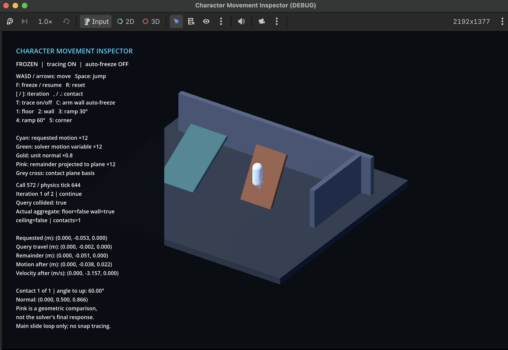

# Godot Movement Inspector

A C++ modification of Godot engine for inspecting how `CharacterBody3D` responds to collisions. A small 3D test scene visualizes the movement requested by the character, the contacts returned by the physics query, and the motion left after the engine's response.

The tool helps investigate character behaviour when it stops at a corner, slides along a wall, or treats a steep ramp as a wall.



## Features

- Capture each iteration of the grounded movement loop, including input motion, travel, remainder, velocity changes, and termination reason.
- Inspect contact positions, normals, depth, and the engine's floor/wall/ceiling classification.
- Compare the geometric projection of remaining motion with the movement algorithm's actual response.
- Freeze character movement, step through recorded iterations and contacts, or automatically freeze on wall contact.
- Reproduce movement cases using floor, wall, 30° ramp, 60° ramp, and a corner wall.

## Implementation

The engine changes are at `character_body_3d.h` and `character_body_3d.cpp`.

Recording takes value snapshots around the existing movement query and response code. Each character stores its latest recorded call, with a limit of 64 steps and an explicit truncation flag. The additions are explicitly guarded by `DEBUG_ENABLED`. It does not change collision-response rules.

Three methods are exposed through Godot's `ClassDB`:

```cpp
void set_movement_trace_enabled(bool p_enabled);
bool is_movement_trace_enabled() const;
Dictionary get_movement_trace() const;
```

The C++ getter calculates surface angles using normalized dot products and inverse cosine, separates remaining displacement into normal and tangent components, and constructs a contact-plane basis using cross products. The GDScript viewer renders the returned data.

## Controls

| Input | Action |
| --- | --- |
| WASD / arrow keys | Move |
| Space | Jump |
| F / R | Freeze or resume / reset |
| [ / ] | Previous / next iteration |
| T | Toggle recording |
| C | Arm or disarm automatic freeze on wall contact |
| 1–5 | Select floor, wall, 30° ramp, 60° ramp, or corner |

Cyan shows requested motion, green shows the motion variable after response, gold shows the contact normal, and pink shows the tangent projection.